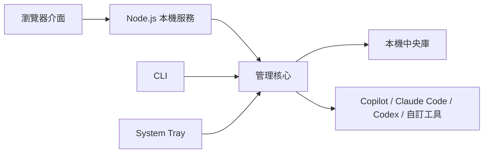

# Skills Manager

**把 AI Skills、Subagents 與 MCP 設定集中在本機管理。**

本專案是 [`xingkongliang/skills-manager`](https://github.com/xingkongliang/skills-manager) 的非官方修改版，套件名稱為 `skills-manager`。架構為 **React 19 前端 + Node.js (Express 5) 本機服務 + System Tray 系統常駐列**，獨立管理 **AI Skills**、**AI Agents (Subagents)** 與 **MCP (Model Context Protocol)**。管理介面與服務綁定在本機，不呼叫原版的更新服務或 GitHub 備份；使用者自行設定的 MCP 命令或端點仍可能連線到外部服務。

`React 19` · `Node.js / Express 5` · `System Tray` · `離線優先`

[快速開始](#快速開始) · [功能一覽](#功能一覽) · [部署與同步](#部署與同步) · [檔案與路徑](#檔案與路徑) · [CLI](#cli) · [常見問題](#常見問題) · [開發與 CI](#開發與-ci)

## 快速開始

請使用 Node.js **26.x**，建議安裝最新的 26.x 穩定版。專案透過 [`.nvmrc`](.nvmrc) 指定版本；使用 nvm 時可執行 `nvm install` 與 `nvm use`。

```bash
git clone https://github.com/iankingh/skills-manager.git
cd skills-manager
npm ci
npm run dev
```

開啟 **[http://127.0.0.1:5173](http://127.0.0.1:5173)** 即可使用。開發模式會同時啟動網頁介面與本機服務；若前端連接埠已被占用，請以前端終端輸出的網址為準。

### 平常使用：先建置，再啟動

```bash
npm run build
npm start
```

開啟 **[http://127.0.0.1:3847](http://127.0.0.1:3847)**。建置後的前端由同一個本機服務提供，不需要另外啟動 Vite。

系統匣圖示可在設定中啟用或停用；建置後也可使用 `npm run tray` 作為啟動入口。關閉瀏覽器後服務仍會繼續執行，直到在終端按下 `Ctrl+C`，或透過系統匣選擇結束服務。

### 第一次使用

1. **確認工具路徑**：到設定頁檢查各 AI 工具的個人資料夾，必要時覆寫路徑或新增自訂工具。
2. **建立中央內容**：匯入 Skills、建立 Subagents，或加入 MCP 伺服器設定。
3. **選擇部署目標**：勾選要使用的工具，執行單筆或批次部署。
4. **確認部署狀態**：檢查中央庫與個人資料夾中的內容，依需求編輯、匯出或建立技能快照。

## 功能一覽

| 模組 | 管理的內容 | 可以做什麼 |
| --- | --- | --- |
| **AI Skills** | 包含 `SKILL.md` 的技能資料夾 | ZIP／資料夾匯入、建立與編輯、搜尋、批次部署、ZIP 匯出 |
| **AI Agents** | `.md`／`.toml` 子代理定義 | 建立角色、匯入與匯出、編輯個人資料夾內容、部署至指定工具 |
| **MCP** | `stdio`／`http`／`sse` 伺服器設定 | 集中管理設定、部署至工具設定檔、檢視與編輯原始 JSON／TOML、ZIP 匯入與匯出 |

另外提供幾個日常入口：

- **個人資料夾檢視**：掃描工具中已有的內容，辨識中央庫管理項目與外部項目。
- **場景預設**：把多個 Skills 組成一組，依工作需求套用。
- **本機快照**：建立 Skills 的 ZIP 快照，還原前會先建立一份安全快照。
- **System Tray**：開啟控制台、重新掃描、切換場景、建立快照或結束服務。

## 部署與同步

中央庫保存來源內容，部署目標則是各 AI 工具的個人／全域路徑。



Skills 支援兩種部署方式，可在設定頁切換：

| 模式 | 運作方式 | 適合的情況 |
| --- | --- | --- |
| **Symlink／Junction** | 工具資料夾連結至中央技能庫；Windows 使用目錄 Junction | 希望工具直接讀取中央內容 |
| **Copy** | 將技能實體複製到目標資料夾 | 需要獨立副本，或環境不便使用連結 |

AI Agents 以檔案副本部署；MCP 則寫入各工具的設定檔。部署與移除 Skills／Agents 時會檢查管理標記及內容，遇到同名個人檔案或已修改的副本會拒絕覆蓋，讓使用者先處理內容差異。

## 檔案與路徑

### 中央資料放在哪裡？

預設使用 `~/.skills-manager/`，也能從設定頁指定其他位置。

```text
~/.skills-manager/
├── skills/       # 中央 Skills 技能庫
├── agents/       # 中央 Subagents 定義檔
├── backups/      # 本機 Skills ZIP 快照
└── db.json       # 設定、MCP、內容中繼資料、場景與操作紀錄
```

設定自訂中央庫後，`~/.skills-manager/repo-config.json` 會記錄其位置。快照的還原範圍為 Skills；AI Agents 與 MCP 可從各自模組匯出 ZIP。

### 預設部署位置

| AI 工具 | Skills | AI Agents | MCP 設定檔 |
| --- | --- | --- | --- |
| **GitHub Copilot** | `~/.copilot/skills/` | `~/.copilot/agents/` | `~/.copilot/mcp-config.json` |
| **Claude Code** | `~/.claude/skills/` | `~/.claude/agents/` | `~/.claude.json` 的 `mcpServers` |
| **OpenAI Codex** | `~/.agents/skills/` | `~/.codex/agents/` | `~/.codex/config.toml` 的 `mcp_servers` |

Copilot 的 Skills 也可在設定中切換到 `~/.agents/skills/`。實際部署位置以設定頁顯示的路徑為準。

<details>
<summary>查看專案層級路徑對照</summary>

以下供辨識各工具的專案設定使用；目前管理器的部署目標以個人／全域路徑為主。

| AI 工具 | Skills | AI Agents | MCP 設定檔 |
| --- | --- | --- | --- |
| GitHub Copilot | `.github/skills/`、`.agents/skills/`、`.claude/skills/` | `.github/agents/` | `.vscode/mcp.json`、`.github/mcp-config.json` |
| Claude Code | `.claude/skills/` | `.claude/agents/` | `.mcp.json` |
| OpenAI Codex | `.agents/skills/` | `.codex/agents/` | `.codex/config.toml` |

</details>

## CLI

CLI 直接使用同一套本機管理核心，不必先開啟網頁或 HTTP 服務。

```bash
# 列出 AI 工具與中央技能
npm run cli -- agents list
npm run cli -- skills list

# 從本機匯入技能
npm run cli -- skills import-zip ./my-skill.zip
npm run cli -- skills import-dir ./my-skill-folder

# 部署至 Codex，或移除該部署
npm run cli -- skills deploy code-review-pro codex
npm run cli -- skills undeploy code-review-pro codex

# 建立本機技能快照
npm run cli -- snapshots create "部署前備份"
```

內建工具代號為 `github_copilot`、`claude_code`、`codex`。執行 `npm run cli -- --help` 可查看完整指令。

## 常見問題

**需要連上外網嗎？**

首次安裝 npm 套件需要網路。管理介面與服務在本機執行，不使用原版更新服務或 GitHub 備份；使用者在 AI 工具中啟用的 MCP 命令或端點仍可能對外連線。

**為什麼使用 `[::1]` 開不了頁面？**

目前前後端都只監聽 IPv4 loopback，請使用 `127.0.0.1`。IPv6 loopback 標頭已可通過驗證，但服務尚未提供 `[::1]` 監聽。

**為什麼系統匣圖示沒有出現？**

先確認設定中的系統常駐列選項已啟用，並在有桌面工作階段的環境執行。系統匣啟動失敗時，可繼續從瀏覽器使用本機服務。

**為什麼部署時提示「不屬於本程式」或「已有本機修改」？**

目標位置有個人檔案，或受管理的副本已被修改。請先檢視並保留所需內容，再決定納管或手動整合，避免同名檔案被覆蓋。

## 開發與 CI

| 指令 | 用途 |
| --- | --- |
| `npm run dev` | 同時啟動 Node.js 與 Vite 開發服務 |
| `npm run dev:server` | 僅啟動後端開發服務 |
| `npm run dev:web` | 僅啟動前端開發服務 |
| `npm test` | 執行後端單元與回歸測試 |
| `npm run lint` | 執行 ESLint 檢查 |
| `npm run build` | 檢查型別並建置前端與後端 |

主要程式位於 `src/`（React 介面）與 `server/`（管理核心、本機服務、CLI、系統匣）。預設後端連接埠為 `3847`，Vite 開發代理也指向此連接埠；若調整後端連接埠，請一併調整開發代理。

開發工具使用 Vite 8、Vitest 5 與 TypeScript 6.0。TypeScript 限定於 `~6.0.3`，因為目前最新版 `typescript-eslint` 的[正式支援範圍](https://typescript-eslint.io/users/dependency-versions/)為 `>=4.8.4 <6.1.0`；待支援 TypeScript 7 後再同步升級。

[CI 工作流程](.github/workflows/ci.yml) 僅在 **`iankingh/skills-manager`** 執行，於推送至 `main` 或建立目標為 `main` 的 Pull Request 時觸發。從 `.nvmrc` 讀取 Node.js 26 版本，在 Ubuntu、macOS、Windows 執行乾淨安裝、測試、Lint 與建置。流程權限為唯讀，Checkout 不保留憑證，也不包含自動提交、推送或發佈步驟。

### GitHub 協作目標

本專案的 PR 目標為 **`iankingh/skills-manager`**。在新的本機 Clone 中使用 GitHub CLI 前，先設定並確認預設儲存庫：

```bash
gh repo set-default iankingh/skills-manager
gh repo set-default --view
```

從功能分支建立 PR 時，明確指定自己的儲存庫與目標分支：

```bash
gh pr create --repo iankingh/skills-manager --base main
```

此設定適用於目前本機 Clone 的 GitHub CLI；若從 GitHub 網頁建立 PR，仍需確認 Base repository 為 `iankingh/skills-manager`、Base branch 為 `main`。

## 來源與授權

本專案為非官方修改版，以 React 與 Node.js 本機服務取代 Tauri／Rust，加入 Subagents、MCP 管理與系統匣入口。保留原專案 Git 歷史，以及原作者 Tianliang Zhang 的著作權聲明，沿用 [MIT 授權](https://github.com/xingkongliang/skills-manager/blob/main/LICENSE)。完整授權內容亦保留於本專案的 [LICENSE](LICENSE)。
